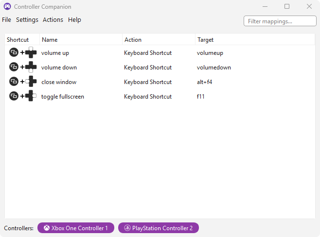
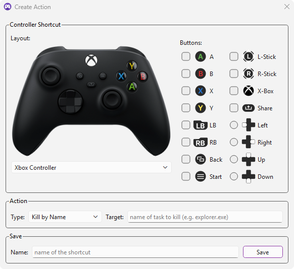

<p align="center">
  
</p>

<h1 align="center">Controller Companion</h1>

<p align="center">
  Easily create controller shortcuts to perform actions on your computer —
  quit a game that has no quit option, control the volume, toggle fullscreen, and more.
</p>

<p align="center">
  <a href="https://pypi.org/project/controller-companion/"></a>
  <a href="https://pypi.org/project/controller-companion/"></a>
  <a href="https://github.com/Johannes11833/controller-companion/releases"></a>
  <a href="https://github.com/Johannes11833/controller-companion/blob/master/LICENSE"></a>
</p>

Controller Companion listens to your connected controllers and triggers an action whenever you press a defined button combination — while gaming, streaming, or anywhere else on your system.

**Supported actions:**
- Terminate a task by its name
- Execute a keyboard shortcut
- Execute any console command

## Features
- GUI and CLI — manage your shortcuts from a window or the terminal
- Supports all controllers that [pygame](https://www.pygame.org) supports (Xbox, PlayStation, 8BitDo, …)
- Runs on Windows, Linux and macOS
- Shows connected controllers as chips that can be enabled or disabled with a click
- Follows your system's light/dark appearance
- Autostart on system startup (Windows only for now)
- Can be compiled into a standalone executable (using [PyInstaller](https://pyinstaller.org))

## Screenshots

<table align="center">
  <tr>
    <td align="center"><br><em>Main window</em></td>
    <td align="center"><br><em>Creating a new shortcut</em></td>
  </tr>
</table>

## Installation
Requires Python 3.10–3.13.

- Using pip:
    ```console
    pip install controller-companion
    ```
- Standalone executables are also available [in the releases](https://github.com/Johannes11833/controller-companion/releases) for Windows, macOS and Linux. An installer is provided for Windows as well.

## Usage

### GUI
```console
controller_companion --ui
```
Add `--minimized` to start the app minimized to the tray.

### CLI
- Multiple shortcuts can be created.
- One or multiple input controller key combinations that trigger an action can be defined with `--input`. The keys of one individual input combination are separated by commas, while each distinct input combination is separated by a space.
- One or multiple actions can be defined with either `--task-kill`, `--console` or `--shortcut`. These actions are mapped to the `--input` key combinations in the order `--task-kill`, `--console` and finally `--shortcut`.
- The mappings saved by the GUI can be loaded with `--config`, or with `--custom-config <file>` using the same file format.
- Example with 2 shortcuts:
    ```console
    controller_companion --input A,B Back,Left --console explorer.exe --shortcut alt+f4
    ```
    will result in the following mapping:
    ```console
    ┏━━━━━━━━━━━━━━━━━━━━━━━━━━━━┳━━━━━━━━━━━┳━━━━━━━━━━━━━━┳━━━━━━┓
    ┃ Name                       ┃ Shortcut  ┃ Action       ┃ Type ┃
    ┡━━━━━━━━━━━━━━━━━━━━━━━━━━━━╇━━━━━━━━━━━╇━━━━━━━━━━━━━━╇━━━━━━┩
    │ Run command "explorer.exe" │ A+B       │ explorer.exe │ Xbox │
    │ Shortcut "alt+f4"          │ Back+Left │ alt+f4       │ Xbox │
    └────────────────────────────┴───────────┴──────────────┴──────┘
    ```

- Run `controller_companion --help` to see all available arguments.

## Build Executable
With [poetry](https://python-poetry.org/) installed, run the following command to build the executable using [PyInstaller](https://pyinstaller.org):
```console
poetry run build_controller_companion_exe
```

## Credits
- Gamepad button icons (Xbox & PlayStation): [80.lv — free button icons for Unreal Engine and Unity](https://80.lv/articles/free-button-icons-for-unreal-engine-and-unity)
- PlayStation 5 controller artwork: [pngall.com](https://www.pngall.com)

## License
This project is licensed under the MIT License — see [LICENSE](LICENSE) for details.
